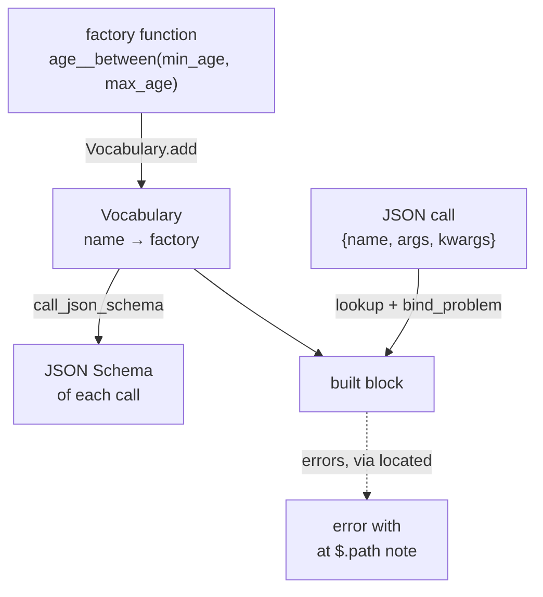

# User guide

pyvocabulary has a handful of small pieces. Each page covers one of them with examples you
can paste and run.

| Piece | What it is | Page |
| --- | --- | --- |
| `Vocabulary[F]` | a read-only registry of named entries | [Vocabularies](vocabulary.md) |
| `validate_name` | the ASCII identifier check every name goes through | [Names](names.md) |
| `bind_problem`, `BindProblem` | what went wrong in a `Signature.bind` | [Argument errors](arguments.md) |
| `json_schema_of`, `call_json_schema` | JSON Schemas from annotations and signatures | [JSON Schema](json-schema.md) |
| `Label`, `Choices`, `labelled`, `Text` | words for people, in one language or several | [Labels and choices](labels.md) |
| `located`, `index_path`, `key_path` | `at $.path` notes on errors | [JSON-path errors](paths.md) |

## The mental model

1. A package registers **factories** in a `Vocabulary` under validated names.
2. Its compiler looks a JSON call's `name` up in the vocabulary and binds the `args` and
   `kwargs`; `bind_problem` turns a binding failure into the package's own exception.
3. `located` adds the JSON path of the failing call to any error, without changing its type.
4. `call_json_schema` describes every visible entry, so editors and validators know what
   the JSON may contain.

pyvocabulary never decides what the JSON document looks like around those calls: the
expression format and the compiler stay in each package.
